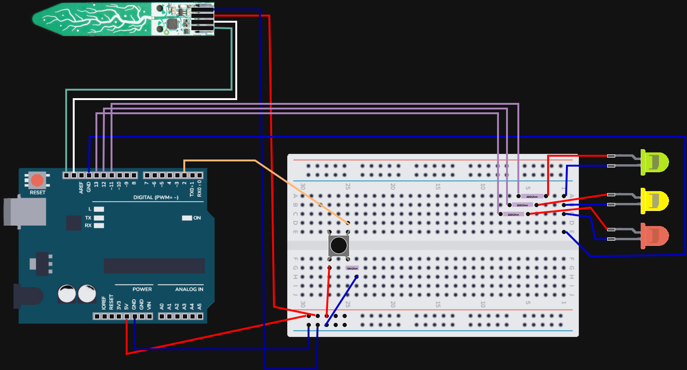

# Auto Herb Watering
System running on a Arduino Uno, when soil of herbs gets too dry will water the plants. 

## Hardware

- Micro Controller: Arduino Uno R3
- Soil Sensor: [Adafruit Seesaw I2C Soil Sensor](https://learn.adafruit.com/adafruit-stemma-soil-sensor-i2c-capacitive-moisture-sensor)
- Basic Push Button

## Code

Main Arduino loop: `AutoHerbWatering.ino` 

Uses:

- SoilSensor (Depends on: Adafruit_seesaw.h)

## Libraries

Install the following libraries through the Arduino IDE (in Toolbar: Sketch > Include Libary > Manage Libraries...)

- Adafruit seesaw

## Calibration Procedure
For the Soil Sensor a calibration procedure has been introduced.

The state of calibration is done using the LED Lights, and User Interaction by push button:
- `Blinking Red` LED: Start of Calibration, put the Soil Sensor in **DRY** soil. Push the `Button` when ready to start measuring.  
- `Normal Red` LED: Taking measurements in Dry Soil.
- `Blinking Yellow` LED: Move the Soil Sensor to **MOIST** soil. Push the `Button` when ready to start measuring.  
- `Normal Yellow` LED: Taking measurements in Moist Soil.
- `Normal Green` LED: Calibration succesfull.

If Calibration was **NOT** succesful, there was not enough difference between the dry & moist soil. You will automatically be returned to the start of Calibration. \
**DO NOT FORGET**: Wipe of the Soil Sensor before placing it in Dry Soil! Droplets of water clinging to the sensor will influence the measurements of the Dry Soil!\
DO NOT TOUCH THE SENSOR WHILE CALIBRATING!
